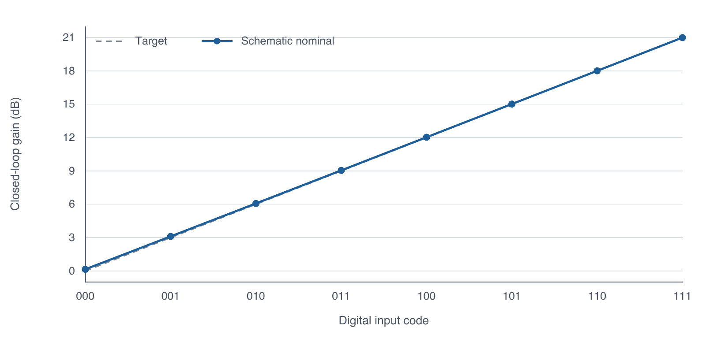

# Programmable-Gain Analog Front End

This is a 1.8 V analog front end from the Advanced Integrated Circuit Design Lab at TU Darmstadt, summer 2026. A programmable-gain amplifier (PGA) sets the gain from 0 to 21 dB in 3 dB steps, and an active low-pass filter (LPF) after it limits the bandwidth to about 100 kHz. Both stages use the same two-stage Miller-compensated OPAMP.

It was a two-person project. I did the schematic design, the testbenches and the final simulations, and put the report together. My teammate designed the OPAMP's current source and bias section and did the layout. The full split is in [contributions](docs/contributions.md).

[Technical report (PDF)](report/AICD_Analog_Front_End.pdf) · [Design notes](docs/design-notes.md) · [Verification](docs/verification.md)

## Results

All results are from Cadence schematic simulations. The OPAMP numbers are at 1.8 V, 27 °C, 0.9 V common mode and a 2 pF load.

| Measurement | Result |
|---|---:|
| OPAMP DC gain | 79.93 dB |
| Gain-bandwidth product | 51.31 MHz |
| Phase margin | 61.97° |
| OPAMP power | 0.3113 mW |
| PGA gain settings | 0–21 dB in 3 dB steps |
| PGA gain tolerance | All eight codes within ±1.5 dB across 64 corners and 100 Monte Carlo samples per code |
| LPF bandwidth | 100.1 kHz nominal, 72.88–121.8 kHz across 64 corners |

Output swing is the one OPAMP spec I missed. It reaches 0.43–1.40 V against a 0.3–1.5 V target. I considered reworking the output stage and bias, but earlier tuning had shown that such changes easily cost slew rate, phase margin, CMRR or power. I did not want to break specs that already passed just to fix swing, so I documented it as a design limitation instead. With fixed test inputs, the PGA still passed all its corner and Monte Carlo runs, but I can't say how large an input each gain setting can take before the output clips.

I checked swing and ICMR only at nominal. The other OPAMP specs pass at all 64 corners. In Monte Carlo, offset is the only metric below 100%, with 28 of 1000 samples beyond ±5 mV.

## How I tuned the OPAMP

I sized the first version with gm/ID hand calculations and then tuned it in simulation. Most changes helped one spec and hurt another. Lowering the Miller capacitor from 1.46 pF to about 0.60 pF improved slew rate but cost phase margin, so I used a series resistor of about 1 kΩ to win it back.

At one point I doubled both W and L of M5, the tail current source, so W/L stayed the same. I expected the bias current and operating point to barely move. The corner run came back with a worst-case phase margin of about 48°, and some specs failed even at nominal. We first suspected the simulation setup or the CSV export, but a rerun in a new session gave the same result. The simulation was right. In a real PDK, the same W/L does not give the same operating point, because the absolute size also changes ro, parasitic capacitance and short-channel effects.

I reverted the change. For the rest of the tuning I changed one parameter at a time, checked the nominal operating point first and only then ran the full corners, instead of working out sizes from the square law.

The other trade-offs and the final sizes are in the [design notes](docs/design-notes.md).

## What's missing

This repo covers the schematic side. Layout was my teammate's part, so it is not included, and there are no post-layout results. I checked the PGA code by code, but I have no transient of it switching between codes. The full list is at the end of [verification](docs/verification.md).

## Repository

| Folder | Contents |
|---|---|
| [report/](report/) | Report PDF, LaTeX source and figures |
| [data/](data/) | Original CSV exports for the OPAMP, PGA and LPF |
| [models/](models/) | Behavioral Verilog-A decoder used in the PGA testbench |
| [docs/](docs/) | Design notes, contributions and verification tables |
| [scripts/](scripts/) | Check script for the CSV exports |

`python3 scripts/summarize_results.py` checks the exports against their limits and regenerates [docs/verification.md](docs/verification.md). It does not simulate anything. Rerunning the circuits needs Cadence and the licensed course PDK, and this repo has neither the PDK nor the original design libraries. [report/README.md](report/README.md) explains how to build the PDF.

There is no open-source license. [NOTICE.md](NOTICE.md) covers attribution and rights.
