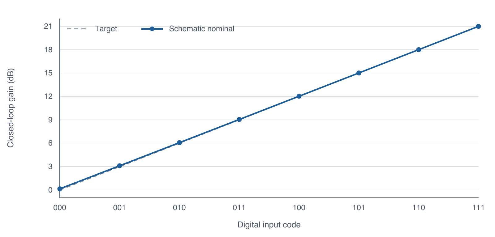

# Programmable-Gain Analog Front End

A 1.8 V analog front end with a two-stage Miller-compensated OPAMP, an eight-step programmable-gain amplifier, and an active low-pass filter. I worked on this project in the Advanced Integrated Circuit Design Lab at TU Darmstadt, summer semester 2026.

My main work covered OPAMP integration and sizing, the PGA and LPF schematics, testbenches, final schematic simulations, and report integration. This was a two-person project; the [contribution statement](docs/contributions.md) gives the task split.

**Start here:** [Technical report](report/AICD_Analog_Front_End.pdf) · [Design decisions](docs/design-notes.md) · [Verification and limits](docs/verification.md)

The implemented signal path is:

```text
Analog input -> programmable inverting PGA -> active LPF -> analog output
```

The PGA uses a resistor feedback string and transmission-gate taps, selected by a behavioral Verilog-A 3-to-8 decoder. A downstream ADC is application context and is outside this project.



## Results

These are archived Cadence schematic-level results. The nominal OPAMP setup is 1.8 V, 27 °C, 0.9 V common mode, and a 2 pF load.

| Measurement | Result |
|---|---:|
| OPAMP DC gain | 79.93 dB |
| Gain-bandwidth product | 51.31 MHz |
| Phase margin | 61.97° |
| OPAMP power | 0.3113 mW |
| PGA gain settings | 0–21 dB in 3 dB steps |
| PGA gain tolerance | All eight codes within ±1.5 dB across 64 corners and 100 Monte Carlo samples per code |
| LPF bandwidth | 100.1 kHz nominal; 72.88–121.8 kHz across 64 corners |

The OPAMP output swing is 0.4302–1.4006 V, short of the 0.3–1.5 V target. Its Monte Carlo offset yield is 972/1000 against a ±5 mV limit. The 64-corner OPAMP export passes all 12 included expressions; it does not include ICMR or output swing.

This portfolio covers schematic design and verification. Teammate layout images and physical-verification screenshots are omitted. No complete extracted-view or PEX performance is claimed.

## Design work

- Sized and tuned the OPAMP around gain, bandwidth, stability, slew rate, noise, and power.
- Designed the eight-tap PGA feedback network and integrated the transmission gates and behavioral controller.
- Designed the active LPF and evaluated its bandwidth, including corner and Monte Carlo variation.
- Built the testbenches, reviewed the final simulation exports, and prepared the schematic-to-layout handoff.

The report includes the sizing progression, operating point, testbenches, and the decisions behind the final values. The OPAMP figure shows the simulated schematic baseline. The full device operating-point CSV is omitted; selected operating-point values remain in the report.

## Repository

| Folder | Contents |
|---|---|
| [report/](report/) | Portfolio PDF, editable LaTeX chapters, and selected original figures |
| [data/](data/) | Original CSV exports for OPAMP, PGA, and LPF results |
| [models/](models/) | Behavioral controller used in the PGA testbench |
| [docs/](docs/) | Design notes, contributions, and verification details |
| [scripts/](scripts/) | Checks and summaries for the archived CSV exports |

To check the data with Python 3, run `python3 scripts/summarize_results.py`. [Report build instructions](report/README.md) are included. These checks read existing exports; rerunning the circuits requires Cadence and the licensed course PDK. Native Cadence libraries, PDK models, and a complete replayable PGA netlist are not included.

AI tools helped with language editing, report formatting, data checks, and this repository's packaging. The numerical results come from the archived simulator exports. See the report's AI declaration and [attribution notes](NOTICE.md).
